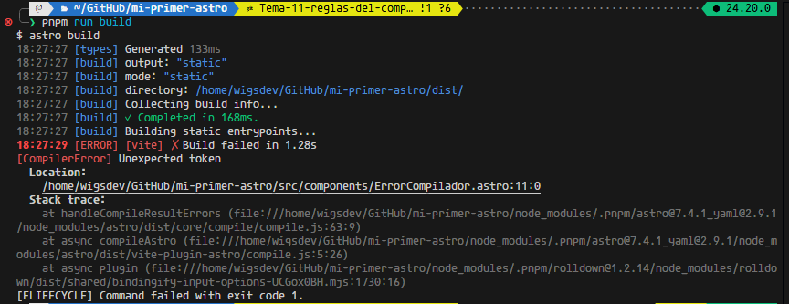
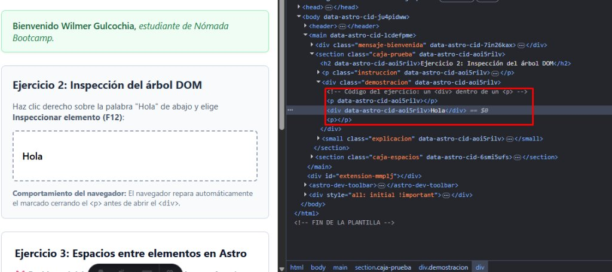
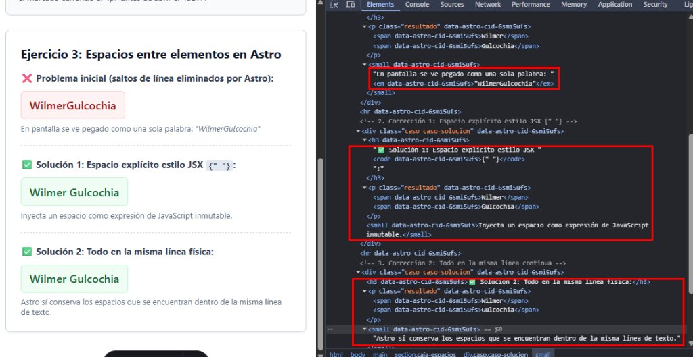

# Ejercicios Sugeridos — Tema 11: Las Reglas del Compilador de Astro 7

## Practica lo aprendido

---

### 1. Provoca el error

> Deja un `<section>` sin cerrar, ejecuta `npm run build` y copia el mensaje. ¿Qué archivo y línea indica?

**Respuesta:**

- **Componente de prueba:** [`src/components/ErrorCompilador.astro`](./src/components/ErrorCompilador.astro)
- **Implementación con error provocado:**

  ```astro
  ---
  // src/components/ErrorCompilador.astro
  ---

  <section>
    <h2>Prueba de error del compilador de Astro</h2>
    <p>Esta etiqueta section se dejó deliberadamente sin cerrar para capturar el error.</p>
  <!-- Falta </section> deliberadamente para provocar CompilerError en Astro 7 -->
  ```

- **Mensaje copiado de la terminal al ejecutar `npm run build`:**

  ```text
  18:27:29 [ERROR] [vite] X Build failed in 1.28s
  [CompilerError] Unexpected token
    Location:
      /home/wigsdev/GitHub/mi-primer-astro/src/components/ErrorCompilador.astro:11:0
  ```

- **Análisis de la información arrojada por el compilador:**
  - **Archivo indicado:** `/home/wigsdev/GitHub/mi-primer-astro/src/components/ErrorCompilador.astro`.
  - **Línea y columna indicada:** Línea `11`, columna `0` (señala el final del archivo donde el analizador sintáctico del compilador esperaba la etiqueta de cierre `</section>`).
  - **Explicación técnica:** A diferencia de los navegadores web (que son permisivos y cierran etiquetas rotas automáticamente), el compilador de Astro es **estricto en tiempo de compilación** para garantizar un marcado válido, predecible y sin errores de hidratación.

- **Evidencia visual del error en la terminal:**

  

---

### 2. Inspecciona

> Escribe `<p><div>Hola</div></p>`, abre DevTools → Elementos y describe cómo quedó el árbol.

**Respuesta:**

- **Componente:** [`src/components/InspeccionarDOM.astro`](./src/components/InspeccionarDOM.astro)
- **Código escrito en la plantilla:**

  ```astro
  <p>
    <div>Hola</div>
  </p>
  ```

- **Árbol resultante en DevTools (F12 → Elementos):**

  ```html
  <p></p>
  <div>Hola</div>
  <p></p>
  ```

- **Descripción y justificación técnica:**
  1. **Regla de la especificación HTML5 (W3C / WHATWG):** Un elemento `<p>` solo puede contener elementos en línea (*phrasing content*, como `<span>`, `<em>`, `<strong>`). Nunca puede contener elementos de bloque (*flow content*, como `<div>`, `<section>`, `<ul>`).
  2. **Reparación del navegador:** Cuando el parser HTML del navegador encuentra la etiqueta de apertura `<div>` mientras procesa un `<p>`, **fuerza el cierre inmediato del párrafo** (`<p></p>`) antes de renderizar el `<div>`.
  3. **Resultado:** El `<div>Hola</div>` es expulsado fuera del párrafo y pasa a ser un **hermano adyacente**, seguido de otro `<p></p>` huérfano generado por el `</p>` de cierre.

- **Evidencia visual del árbol DOM en DevTools:**

  

---

### 3. Espacios

> Escribe un nombre y apellido en dos `<span>` en líneas distintas. Corrígelo de dos formas diferentes.

**Respuesta:**

- **Componente:** [`src/components/EspaciosNombres.astro`](./src/components/EspaciosNombres.astro)

- **El problema inicial (Saltos de línea eliminados):**

  ```astro
  <p>
    <span>Wilmer</span>
    <span>Gulcochia</span>
  </p>
  ```
  *Resultado en pantalla:* Se muestra como una sola palabra sin separación: **`WilmerGulcochia`**, porque Astro colapsa los saltos de línea entre etiquetas contiguas en la plantilla.

- **Forma 1 de corrección: Espacio explícito estilo JSX (`{" "}`)**

  ```astro
  <p>
    <span>Wilmer</span>{" "}
    <span>Gulcochia</span>
  </p>
  ```
  *Explicación:* La expresión `{ " " }` evalúa un string de espacio en blanco en JavaScript, el cual Astro no puede descartar, garantizando la separación entre ambos spans.

- **Forma 2 de corrección: Todo en la misma línea física**

  ```astro
  <p><span>Wilmer</span> <span>Gulcochia</span></p>
  ```
  *Explicación:* El compilador de Astro sí preserva los caracteres de espacio en blanco que se encuentran dentro de la misma línea de código.

- **Evidencia visual en pantalla y en DevTools:**

  
