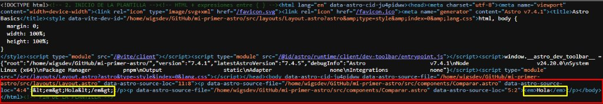

# Ejercicios Sugeridos — Tema 9: Insertar HTML con set:html

## Practica lo aprendido

---

### 1. Compara

> Muestra la misma cadena `"<em>Hola</em>"` con `{ }` y con `set:html`. Revisa el código fuente generado (Ctrl + U).

**Respuesta:**

- **Componente:** [`src/components/Comparar.astro`](./src/components/Comparar.astro)
- **Implementación:**
  ```astro
  ---
  const cadena = "<em>Hola</em>";
  ---

  <p>{cadena}</p>
  <p set:html={cadena} />
  ```
- **Inspección en el código fuente (`Ctrl + U`):**
  - **Con `{cadena}`:** Astro convierte los caracteres especiales a entidades HTML seguras:
    ```html
    <p>&lt;em&gt;Hola&lt;/em&gt;</p>
    ```
    *(En pantalla se lee literalmente `<em>Hola</em>` como texto plano).*
  - **Con `set:html={cadena}`:** Astro inserta las etiquetas HTML sin escapar:
    ```html
    <p><em>Hola</em></p>
    ```
    *(En pantalla el navegador interpreta la etiqueta y muestra la palabra en cursiva real).*

- **Evidencia visual del código fuente generado:**

  

---

### 2. Piensa como atacante

> Si un visitante escribe `` en un comentario y lo muestras con `set:html`, ¿qué pasaría?

**Respuesta:**

Se produce una vulnerabilidad crítica de **XSS (Cross-Site Scripting)**:

1. **Mecanismo del ataque:** El navegador intenta cargar la imagen desde una dirección inexistente (`src="x"`). Al fallar de forma inmediata, se dispara el controlador de evento `onerror`.
2. **Impacto:** El navegador ejecuta el código JavaScript inyectado (`alert(1)`). En un escenario real, un atacante podría robar cookies de sesión, tokens de autenticación almacenados en `localStorage` o redirigir al usuario a sitios maliciosos.
3. **Protección por defecto en Astro:** Si se utiliza `{comentario}` en lugar de `set:html`, Astro escapa automáticamente las etiquetas:
   ```html
   &lt;img src=x onerror=&quot;alert(1)&quot;&gt;
   ```
   El código se neutraliza por completo y se muestra únicamente como texto inofensivo.

> **Regla de seguridad:** **Nunca** se debe usar `set:html` con datos ingresados por usuarios externos no confiables (formularios, comentarios, foros), a menos que pasen previamente por un proceso de sanitización riguroso con librerías como `sanitize-html` o `DOMPurify`.

---

### 3. Clasifica

> Para 4 fuentes de datos de un blog (posts, comentarios, biografía del autor, API del clima) decide si usarías `set:html`.

**Respuesta:**

| Fuente de datos | ¿Usar `set:html`? | Justificación técnica y de seguridad |
| :--- | :---: | :--- |
| **1. Posts del blog** | **SÍ** | Es contenido confiable redactado por autores del equipo / CMS. Requiere renderizar formato HTML enriquecido (encabezados, listas, negritas, enlaces, imágenes). |
| **2. Comentarios de visitantes** | **NO** | Es contenido generado por usuarios desconocidos (no confiable). Usar `set:html` expondría la aplicación a ataques XSS. Debe mostrarse con `{ }` para que Astro lo escape. |
| **3. Biografía del autor** | **SÍ** | Proviene de una fuente confiable y controlada (perfil interno del CMS). Es común que incluya formato como negritas y enlaces a redes sociales o portafolio. |
| **4. API del clima** | **NO** | Proporciona datos estructurados puros (números y cadenas simples como `"21°C"` o `"Despejado"`). No contiene etiquetas HTML, por lo que `{temperatura}` es suficiente, seguro y adecuado. |
