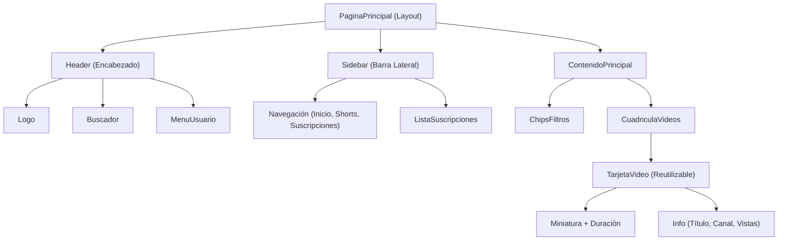

# Ejercicios Sugeridos — Tema 4: Importar y Anidar Componentes

## Practica lo aprendido

---

### 1. Header compartido

> Crea `Header.astro` y úsalo en `index.astro` y `sobre-mi.astro`. Cambia un enlace y comprueba que se actualiza en ambas.

**Respuesta:**

- **Componente central:** [`src/components/Header.astro`](./src/components/Header.astro)
- **Páginas que lo consumen:**
  - [`src/pages/index.astro`](./src/pages/index.astro) (Ruta `/`)
  - [`src/pages/sobre-mi.astro`](./src/pages/sobre-mi.astro) (Ruta `/sobre-mi`)
- **Explicación:** Al centralizar la navegación y el logo en `Header.astro`, se aplica el principio **DRY (Don't Repeat Yourself)**. Al agregar o modificar cualquier enlace dentro de `Header.astro` (por ejemplo, el enlace a `/blog/primer-post`), el cambio se refleja inmediatamente en ambas páginas sin tener que editar cada una por separado.

---

### 2. Rutas y rutas relativas

> Crea `src/pages/blog/primer-post.astro` e importa el Header. ¿Qué ruta relativa necesitas?

**Respuesta:**

- **Ruta relativa necesaria:**
  ```astro
  import Header from "../../components/Header.astro";
  ```
- **Archivo creado:** [`src/pages/blog/primer-post.astro`](./src/pages/blog/primer-post.astro) (Ruta accesible en el navegador: `/blog/primer-post`).
- **Explicación del cálculo de ruta:**
  1. El archivo se encuentra en `src/pages/blog/` (dos niveles de profundidad dentro de `src/`).
  2. El primer `../` sube a `src/pages/`.
  3. El segundo `../` sube a `src/`.
  4. Desde `src/` se ingresa a la carpeta de componentes con `components/Header.astro`.

---

### 3. Dibuja el árbol de componentes de YouTube

> Dibuja el árbol de componentes de la página principal de YouTube (encabezado, barra lateral, tarjetas de video…).

**Respuesta:**

Al analizar la página principal de YouTube desde una arquitectura de componentes web, la interfaz se descompone en la siguiente jerarquía:

```
📦 PaginaPrincipal (Layout)
├── 🏷️ Header (Encabezado)
│   ├── 🔹 Logo
│   ├── 🔹 Buscador (Input + Botón Buscar + Micrófono)
│   └── 🔹 MenuUsuario (Botón Crear, Notificaciones, Avatar)
│
├── 📑 Sidebar (Barra Lateral)
│   ├── 🔹 NavPrincipal (Inicio, Shorts, Suscripciones)
│   ├── 🔹 NavBiblioteca (Historial, Tus videos, Ver más tarde)
│   └── 🔹 ListaSuscripciones
│       └── 🔸 CanalItem (Avatar + Nombre del canal)
│
└── 🎬 ContenidoPrincipal
    ├── 🔹 ChipsFiltros (Categorías: Todos, Música, Videojuegos, etc.)
    └── 🔹 CuadriculaVideos (Grid)
        └── 🔸 TarjetaVideo (repetido dinámicamente con .map)
            ├── ▫️ Miniatura (Imagen preview + Duración)
            ├── ▫️ AvatarCanal
            └── ▫️ InfoVideo (Título, Nombre canal, Vistas, Antigüedad)
```

#### Diagrama de dependencias (Mermaid):


