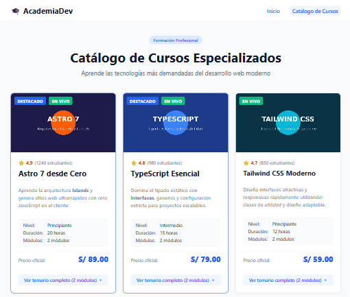

# 🎓 AcademiaDev — Catálogo de Cursos Especializados (Reto 2 de 3)

Aplicación web educativa de catálogo de cursos para desarrolladores, construida con Astro utilizando arquitectura basada en componentes, renderizado estático (0 KB de JavaScript en el cliente) y separación estricta de responsabilidades (datos, componentes, layouts y estilos globales).



---

## 🎯 Requisitos del Reto y Solución

- [x] **1. Arreglo de 4 cursos en `src/data/cursos.json`:**
  - Definición desacoplada de 4 cursos tecnológicos (Astro 7, TypeScript, Tailwind CSS y Node.js & APIs REST), cada uno con `nombre`, `nivel`, `horas`, `modulos` (con sus `temas`), `precio`, `imagen` y `descripcionHtml`.

- [x] **2. Etiqueta dinámica por curso (`h2` vs `h3`):**
  - En [`src/components/CursoCard.astro`](./src/components/CursoCard.astro), el título se renderiza dinámicamente mediante una variable en PascalCase:
    ```astro
    const TituloTag = destacado ? "h2" : "h3";
    ```
  - Cursos destacados utilizan `<h2>` y los regulares `<h3>`, optimizando la semántica y jerarquía visual del documento.

- [x] **3. Lista anidada de módulos y temas con dos `map()`:**
  - El primer `.map()` recorre los módulos y el segundo sus temas.
  - Se implementó dentro de un acordeón nativo HTML5 (`<details>` y `<summary>`) para mantener la tarjeta compacta (estándar UX tipo Udemy/Platzi) sin necesidad de librerías ni JavaScript en el cliente.

- [x] **4. Ficha técnica en `<dl>` con fragmentos (`<>...</>`):**
  - La información de nivel, duración y total de módulos se estructura en pares `<dt>` y `<dd>` agrupados con fragmentos de Astro, garantizando una relación semántica válida sin introducir `<div>` envoltorios que rompan el árbol DOM.

- [x] **5. Descripción enriquecida con `<Fragment set:html>`:**
  - Inyección segura de HTML confiable para resaltar conceptos con `<strong>` y `<em>` dentro de la descripción comercial del curso.

- [x] **6. Estado vacío condicional ("Pronto más cursos"):**
  - En [`src/pages/catalogo.astro`](./src/pages/catalogo.astro), se evalúa `cursos.length === 0 ? <p>Pronto más cursos</p> : ...` para mostrar un estado visual de cortesía cuando no existen cursos disponibles.

- [x] **7. Arquitectura profesional de 3 pilares y estilos en inglés:**
  - **Layout base:** [`src/layouts/Layout.astro`](./src/layouts/Layout.astro) compartido con encabezado, pie de página y enlace activo.
  - **Componente atómico:** [`src/components/CursoCard.astro`](./src/components/CursoCard.astro) reutilizable con el operador spread (`<CursoCard {...curso} />`).
  - **Diseño responsivo con `clamp()`:** Adaptabilidad en una sola línea (3 cursos en desktop, 2 en tablet y 1 en móvil) y variables en [`src/styles/global.css`](./src/styles/global.css).
  - Todas las clases CSS estandarizadas en inglés (`.container`, `.course-card`, `.navbar`, `.footer`, etc.).

- [x] **8. Build 100% estático:**
  - `npm run build` compila con éxito (0 errores) generando la carpeta `dist/` con 0 archivos `.js` de cliente.

---

## 📁 Estructura del Proyecto

```text
mi-primer-astro/
├── assets/
│   └── captura-catalogo.png
├── public/
│   └── img/
│       └── cursos/
│           ├── astro.jpg
│           ├── nodejs.jpg
│           ├── tailwind.jpg
│           └── typescript.jpg
├── src/
│   ├── components/
│   │   ├── CursoCard.astro
│   │   ├── Footer.astro
│   │   └── Header.astro
│   ├── data/
│   │   └── cursos.json
│   ├── layouts/
│   │   └── Layout.astro
│   ├── pages/
│   │   ├── catalogo.astro
│   │   └── index.astro
│   └── styles/
│       └── global.css
├── README.md
└── package.json
```

---

## 🛠️ Comandos de ejecución

```bash
# Iniciar servidor local de desarrollo
npm run dev

# Compilar para producción (Static Site Generation)
npm run build

# Verificar que dist/ no contiene archivos JavaScript
find dist/ -type f -name "*.js" | wc -l
```
