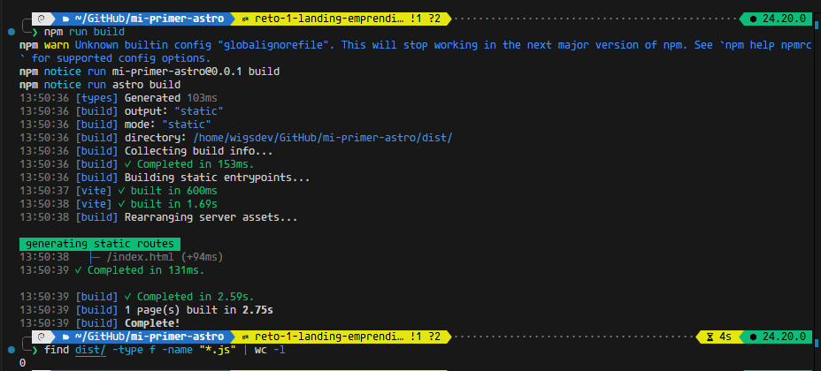

# ⚡ UchizaTech — Landing de Emprendimiento (Reto 1 de 3)

Proyecto de página de inicio para una tienda tecnológica de productos para setups y creadores de contenido, construido íntegramente con componentes `.astro` y arquitectura estática (0 KB de JavaScript en el cliente).


---

## 🎯 Requisitos del Reto y Solución

- [x] **1. Componentes modulares en `src/components/`:**
  - [`Header.astro`](./src/components/Header.astro): Encabezado con logotipo y menú de navegación.
  - [`Hero.astro`](./src/components/Hero.astro): Sección destacada con propuesta de valor y llamado a la acción.
  - [`Card.astro`](./src/components/Card.astro): Tarjeta de producto con imagen, categoría, nombre y precio formateado.
  - [`Footer.astro`](./src/components/Footer.astro): Pie de página con dirección, redes sociales y copyright.

- [x] **2. Menú y redes generados con `map()`:**
  - El menú en `Header.astro` se genera mapeando un arreglo de enlaces `{ texto, url }`.
  - Las redes sociales en `Footer.astro` se generan mapeando un arreglo `{ nombre, url }`.

- [x] **3. Sección de productos desde `src/data/productos.json`:**
  - Los productos provienen del archivo [`src/data/productos.json`](./src/data/productos.json).
  - En [`src/pages/index.astro`](./src/pages/index.astro), se filtran usando `.filter((p) => p.disponible)` para mostrar únicamente los productos con stock disponible en tienda.

- [x] **4. Insignia condicional en tarjeta:**
  - `Card.astro` renderiza condicionalmente la etiqueta `<span class="badge-nuevo">Nuevo</span>` evaluando la propiedad `{nuevo && ...}`.

- [x] **5. Año dinámico y comentarios `{/* */}`:**
  - El pie de página calcula el año automáticamente en tiempo de compilación con `new Date().getFullYear()`.
  - Cada componente (`Header.astro`, `Footer.astro`, `Hero.astro`, `Card.astro` e `index.astro`) contiene al menos un comentario con formato JSX/Astro `{/* ... */}` en su plantilla.

- [x] **6. Build 100% estático:**
  - `npm run build` compila con éxito (0 errores) y genera la carpeta `dist/` con 0 archivos `.js` de cliente (`find dist/ -type f -name "*.js" | wc -l` retorna `0`).

  

---

## 📁 Estructura del Proyecto

```text
mi-primer-astro/
├── assets/
│   ├── captura-build-sin-js.png
│   └── captura-landing.png
├── public/
│   └── img/
│       ├── auriculares.jpg
│       ├── laptop.jpg
│       ├── monitor.jpg
│       └── teclado.jpg
├── src/
│   ├── components/
│   │   ├── Card.astro
│   │   ├── Footer.astro
│   │   ├── Header.astro
│   │   └── Hero.astro
│   ├── data/
│   │   └── productos.json
│   └── pages/
│       └── index.astro
├── README.md
└── package.json
```

---

## 🛠️ Comandos de ejecución

```bash
# Iniciar servidor de desarrollo
npm run dev

# Compilar para producción (Static Site Generation)
npm run build
```
